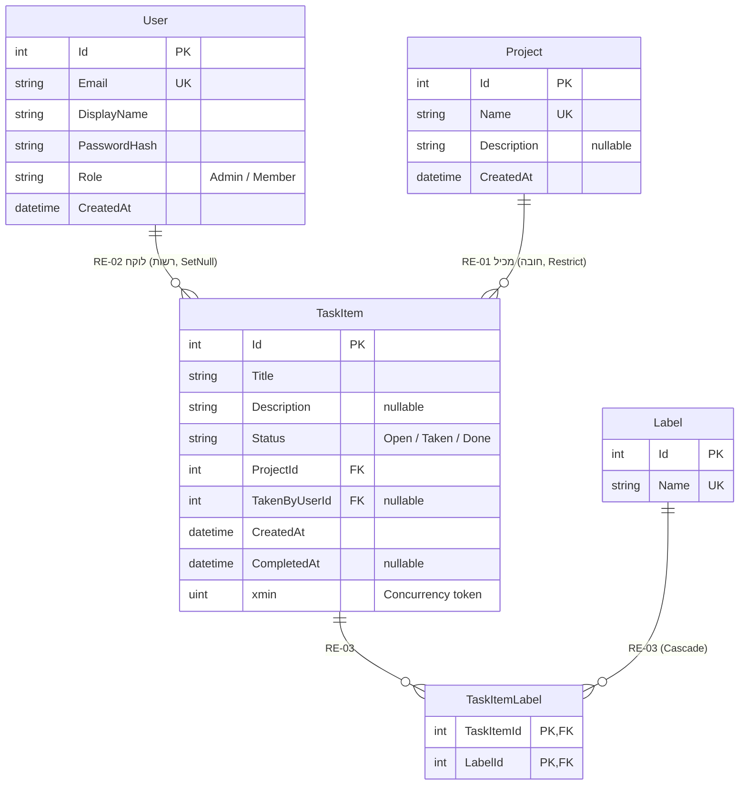

# מסמך ניתוח 2 – Data: מודל פיזי, קשרים ו-Seed

מערכת ניהול משימות .NET. שכבה: Data. משמש את משימות הפיתוח 7–13 (ראו dev-tasks.md). מזהים ממסמכים אחרים – לפי האינדקס (00-index.md).

## קשרים

### דיאגרמת טבלאות וקשרים (ERD)

- מקרא: PK – מפתח ראשי; FK – מפתח זר; UK – ייחודי; ||--o{ – אחד לרבים. TaskItemLabel – טבלת הקישור של ה-many-to-many.
- במסמך המופק הדיאגרמה מוצגת כתמונה.

### טבלת קשרים

| # | מקור | יעד | סוג | נשמר ב- | חובה | התנהגות במחיקה |
|---|---|---|---|---|---|---|
| RE-01 | Project | TaskItem | one-to-many | TaskItem.ProjectId | כן | חסימה – OnDelete(Restrict) |
| RE-02 | User | TaskItem | one-to-many | TaskItem.TakenByUserId | לא | OnDelete(SetNull); חסימת Taken ב-Service |
| RE-03 | TaskItem | Label | many-to-many | טבלת TaskItemLabel | לא | מחיקת תווית – ניתוק מהמשימות (Cascade על טבלת הקישור בלבד) |

- כלל RE-01-R1: מחיקת פרויקט שיש בו משימה אחת או יותר ← 409 "לא ניתן למחוק פרויקט שיש בו משימות". (עמימות 11)
- כלל RE-01-R2: מחיקת פרויקט בלי משימות ← 204.
- כלל RE-02-R1: לפני מחיקת משתמש, ה-Service בודק אם יש לו משימה ב-Status=Taken ← 409 ללא מחיקה.
- כלל RE-02-R2: אם הבדיקה עברה – PostgreSQL מאפס TakenByUserId ל-null במשימות Done של המשתמש (SetNull).

| מצב משימות המשתמש | תוצאה |
|---|---|
| אין משימות | 204 |
| כולן Done | 204; TakenByUserId ← null |
| לפחות אחת Taken | 409 |

## Migrations
- כלל DA-01: מיגרציה 1 – כל הטבלאות והשדות, כולל מיפוי xmin, למעט CompletedAt; מיגרציה 2 – הוספת CompletedAt (EN-04-R5, מסמך 1).
- כלל DA-02: אינדקסים ייחודיים לא רגישים לאותיות: User.Email, Project.Name, Label.Name (EN-01 עד EN-03).

## Repositories
- כלל DA-03: סינון, מיון, ספירה ו-pagination בתוך השאילתה (GN-02, מסמך 4); AsNoTracking בכל קריאה; Include/ThenInclude במקום שאילתה בתוך לולאה.
- כלל DA-04: ה-Repository תופס רק את חריגת הייחודיות של בסיס הנתונים ומחזיר אותה כהתנגשות (GN-12, מסמך 3).

### GN-11: גבולות ה-Concurrency
- כלל GN-11-R1: xmin ממופה כ-Concurrency token רק ב-TaskItem (EN-04-R3).
- כלל GN-11-R2: ב-User, Project ו-Label – "האחרון שומר מנצח", בלי בדיקת התנגשות.

### GN-05: נתוני Seed

| ישות | כמות ופרטים |
|---|---|
| User | 30: 1 Admin ו-29 Member |
| Project | 10 פרויקטים, עם שם ותיאור לדוגמה |
| Label | 10 תוויות |
| TaskItem | 100 משימות, מפוזרות בין 10 הפרויקטים, כולן Open; חלקן עם תוויות |

- כלל GN-05-R1: סיסמאות לפי כלל קבוע ממוספר – Demo1234!1 עד Demo1234!30, לפי סדר יצירה (Demo1234!1 למנהל). הכלל יתועד ב-README.
- כלל GN-05-R2: הסיסמאות עומדות ב-EN-01-R1 (8–64 תווים, אות וספרה).
- כלל GN-05-R3: ה-Seed נטען אוטומטית בעדכון בסיס הנתונים, בלי התערבות ידנית; בסיס הבדיקות נוצר מחדש לפני כל הרצה וטוען את אותם נתונים.
- כלל GN-05-R4: Admin היחיד במערכת הוא זה שנוצר ב-Seed (RL-01).
